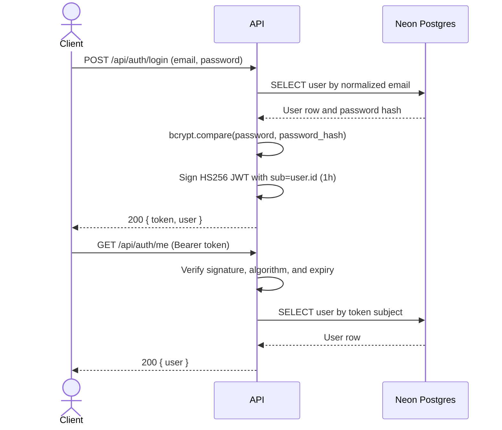

# Notes API

A Node.js 20 / Express 5 REST API backed by Neon Postgres. It supports account registration and login, JWT authentication, and user-owned notes.

## Setup

1. Install Node.js 20 and dependencies:

   ```sh
   npm install
   ```

2. Create a Neon project and a development branch. In the Neon SQL Editor connected to the development branch, run [`src/db/schema.sql`](./src/db/schema.sql).

3. Create a separate Neon branch for tests (for example, `test`) and copy its connection string. A Neon branch is an isolated database branch with its own endpoint; test inserts and cleanup are kept off the development/production branch. Never set `TEST_DATABASE_URL` to the production connection string.

4. Copy `.env.example` to `.env`, then set the development connection string, test-branch connection string, and a random JWT secret of at least 32 characters:

   ```env
   DATABASE_URL=postgresql://...development-branch...
   TEST_DATABASE_URL=postgresql://...test-branch...
   JWT_SECRET=your-random-secret-of-at-least-32-characters
   PORT=3000
   ```

   Keep `.env` private; it is ignored by Git. Generate a secret with:

   ```sh
   node --input-type=module -e "import { randomBytes } from 'node:crypto'; console.log(randomBytes(32).toString('hex'))"
   ```

5. Start the server and run the integration tests:

   ```sh
   npm run dev
   npm test
   ```

   The tests require `TEST_DATABASE_URL`, switch the app to that URL before importing it, create the tables if needed, and delete only their uniquely named test users afterward. They refuse to run if `TEST_DATABASE_URL` points to the same Neon endpoint as `DATABASE_URL` (pooler/non-pooler host variants are normalized for this check).

Use [`requests.http`](./requests.http) with the VS Code REST Client extension to try the endpoints. Run the register request before login, then use the login response token for protected calls.

## Endpoints

All responses are JSON except `DELETE /api/notes/:id`, which returns `204 No Content`. Protected routes require `Authorization: Bearer <token>`.

| Method | Path | Auth | Description |
| --- | --- | --- | --- |
| `GET` | `/api/health` | No | Health and database connectivity check |
| `POST` | `/api/auth/register` | No | Create an account and return a user and token |
| `POST` | `/api/auth/login` | No | Log in and return a user and token |
| `GET` | `/api/auth/me` | Yes | Return the authenticated user |
| `GET` | `/api/notes?q=&tag=&pinned=&page=&limit=` | Yes | List the current user's notes with search, filters, and pagination |
| `GET` | `/api/notes/:id` | Yes | Get one of the current user's notes |
| `POST` | `/api/notes` | Yes | Create a note |
| `PATCH` | `/api/notes/:id` | Yes | Update a note and its `updated_at` timestamp |
| `DELETE` | `/api/notes/:id` | Yes | Delete a note |

List responses contain `notes` and `pagination` (`page`, `limit`, `total`, and `totalPages`). Validation failures return `422`; a missing, invalid, or expired token returns `401`; notes that do not exist or belong to another user return `404`.

## Authentication flow



## Security

- Passwords are hashed with `bcryptjs` using cost 12; password hashes are never returned by API routes.
- JWTs contain the user ID in `sub`, are signed with HS256, and expire after one hour. JWTs are signed, not encrypted: their payload is readable, so never put passwords, password hashes, secrets, API keys, or other sensitive data in them.
- Protected routes verify Bearer tokens with HS256 explicitly allowed; failures return `401` with `WWW-Authenticate`.
- Notes queries are parameterized and scoped to the authenticated `user_id`. Create derives ownership from the token, while read/update/delete return `404` for another user's note to avoid confirming that the note exists.
- Zod validates request bodies, note IDs, and list filters.
- Auth routes are rate-limited to 10 requests per 15 minutes per IP. Helmet, restricted CORS origins, and a 100 KB JSON body limit are enabled.

### Expired-token request

To try the expired-token case in `requests.http`, generate a token using the same secret as the running server, then paste it into `@expiredToken`:

```sh
node --env-file=.env --input-type=module -e "import jwt from 'jsonwebtoken'; console.log(jwt.sign({ sub: '00000000-0000-4000-8000-000000000001' }, process.env.JWT_SECRET, { algorithm: 'HS256', expiresIn: -1 }))"
```
